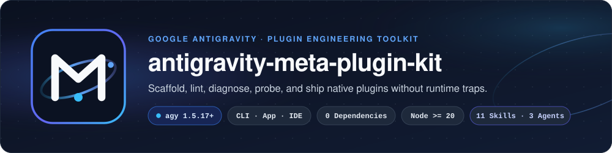
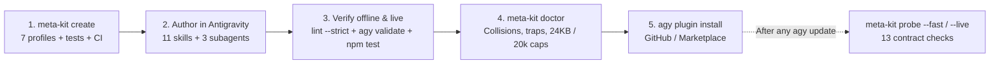

<div align="center">

<a href="https://antigravity.google">
  <picture>
    <source media="(prefers-color-scheme: dark)" srcset="docs/assets/banner-dark.svg" />
    <source media="(prefers-color-scheme: light)" srcset="docs/assets/banner-light.svg" />
    
  </picture>
</a>

<br />

[](https://antigravity.google)
[](docs/guides/plugin-manifest.md)
[](https://github.com/sipki-tech/antigravity-meta-plugin-kit/actions/workflows/ci.yml)
[](package.json)
[](package.json)
[](LICENSE)

<p>
  <strong>Scaffold, lint, diagnose, probe, and ship <a href="https://antigravity.google">Google Antigravity</a> plugins without hitting silent runtime traps.</strong><br />
  Zero-dependency Node.js toolkit calibrated against live <code>agy 1.5.17 / 1.5.18</code> probes — unified CLI, modular offline CI linter, local environment doctor, fail-open hook SDK, 11 skills, 3 isolated subagents, and bilingual guides.
</p>

<p>
  <strong>English</strong> · <a href="README.ru.md">Русский</a>
  &nbsp;&nbsp;|&nbsp;&nbsp;
  <a href="#quick-start-30-seconds">Quick Start</a> ·
  <a href="#choose-a-scaffold-profile">Profiles</a> ·
  <a href="#unified-cli-meta-kit">CLI</a> ·
  <a href="#skills--isolated-subagents">Skills &amp; Agents</a> ·
  <a href="#guides--trap-registry">Guides</a>
</p>

</div>

---

## How it fits together



## Quick start (30 seconds)

### 1. Install in Antigravity (recommended)

Install once globally with the native Antigravity CLI — zero npm install, zero global hooks, zero always-on rule bloat:

```bash
agy plugin install https://github.com/sipki-tech/antigravity-meta-plugin-kit
```

Optional shell alias so you can run `meta-kit` from any repository without cloning this repo:

```bash
alias meta-kit='node ~/.gemini/config/plugins/antigravity-meta-plugin-kit/scripts/meta-kit.mjs'
```

*(Prefer per-project scoping? Vendor `plugins/antigravity-meta-plugin-kit/` under `<project>/.agents/plugins/antigravity-meta-plugin-kit/` and commit it. Update anytime by re-running `agy plugin install` — Antigravity swaps atomically.)*

### 2. Scaffold & verify your first plugin

```bash
meta-kit create my-plugin --with-agents
cd my-plugin
npm test                                               # zero-dep node:test suite (green out of the box)
meta-kit lint --strict .                               # offline strict lint + runtime blind spots
agy plugin validate --strict --json plugins/my-plugin  # Google's authoritative validator (findings: [])
agy plugin install plugins/my-plugin                   # install locally into Antigravity
```

### 3. Add offline strict lint to GitHub Actions

GitHub-hosted runners do not preinstall `agy`. Drop this step into any Antigravity plugin repository to enforce `agy --strict` parity and catch runtime blind spots on every PR:

```yaml
- uses: actions/setup-node@v4
  with:
    node-version: "22"
- run: npm test
- name: Offline strict Antigravity plugin lint
  run: |
    git clone --depth 1 https://github.com/sipki-tech/antigravity-meta-plugin-kit /tmp/meta-kit
    node /tmp/meta-kit/plugins/antigravity-meta-plugin-kit/scripts/meta-kit.mjs lint --strict .
```

## Choose a scaffold profile

Every profile passes `npm test`, `meta-kit lint --strict`, and `agy plugin validate --strict --json` (`findings: []`) out of the box:

| Goal | Command | What it generates |
|---|---|---|
| Standard plugin (hooks + MCP + skill + rule) | `meta-kit create my-plugin` | Flat `plugin.json`, `assets/logo.svg`, `README.md`, `rules/AGENTS.md`, fail-open `PreToolUse` guard (`io.mjs`), skill, `mcp_config.json`, tests, CI |
| Lean skill/rule-only plugin | `meta-kit create my-plugin --minimal` | Omits `hooks.json`, hook scripts, and `mcp_config.json` |
| Google Workspace pattern (CLI + `auth.json` + skill) | `meta-kit create my-plugin --minimal --with-cli` | Bundled zero-dep Node CLI (`scripts/cli.mjs`), `auth.json`, CLI skill, `test/cli.test.mjs` — zero MCP overhead |
| Custom subagent + `/cmd` wrapper | `meta-kit create my-plugin --with-agents` | Canonical `agents/<name>-helper.md` (`model: inherit`, `inheritMcp: false`) + slash-only `/<name>-help` skill |
| Background worker sidecar | `meta-kit create my-plugin --with-sidecar` | `sidecars/<name>-worker/sidecar.json` + graceful `SIGTERM`/`SIGINT` `worker.mjs` |
| `.antigravity-plugin/` manifest layout | `meta-kit create my-plugin --manifest-layout dot-antigravity` | Places `plugin.json` in `.antigravity-plugin/` while keeping all components at plugin root |

Add `--dry-run` to any command to preview the exact file plan without writing to disk.

<details>
<summary><strong>Inspect the generated repository tree</strong></summary>

```text
my-plugin/
├── plugins/my-plugin/
│   ├── plugin.json               # flat agy 1.5.17+ strict JSON (or .antigravity-plugin/plugin.json)
│   ├── README.md                 # Marketplace UI readme
│   ├── assets/logo.svg           # 256×256 square SVG with ~10% padding (0 validator notes)
│   ├── rules/AGENTS.md           # always-on rule (no frontmatter, Google recommendation)
│   ├── hooks.json                # root strict JSON, fail-open PreToolUse guard (omitted with --minimal)
│   ├── scripts/example-guard.mjs + scripts/lib/io.mjs   # symlink-safe, fail-open hook SDK
│   ├── skills/my-plugin-example/SKILL.md + resources/prompt-template.md
│   ├── skills/my-plugin-help/SKILL.md                   # --with-agents (disable-model-invocation: true)
│   ├── skills/my-plugin-cli/SKILL.md                    # --with-cli
│   ├── agents/my-plugin-helper.md                       # --with-agents (model: inherit, inheritMcp: false)
│   ├── sidecars/my-plugin-worker/sidecar.json           # --with-sidecar
│   ├── auth.json + scripts/cli.mjs                      # --with-cli (Google Workspace pattern)
│   └── mcp_config.json                                  # omitted with --minimal
├── test/                         # node:test suites (hook.test.mjs + manifest.test.mjs + cli.test.mjs)
├── README.md
└── .github/workflows/ci.yml      # Node 20/22 × ubuntu/macos + agy plugin validate --strict
```

</details>

## Unified CLI (`meta-kit`)

All four commands live behind `scripts/meta-kit.mjs` (direct `create.mjs`, `lint.mjs`, `doctor.mjs`, and `probe.mjs` scripts remain 100% compatible):

| Command | Purpose | Key flags |
|---|---|---|
| `meta-kit create <name>` | Scaffold a tested, zero-warning plugin repo | `--minimal`, `--with-agents`, `--with-sidecar`, `--with-cli`, `--manifest-layout`, `--dir`, `--dry-run` |
| `meta-kit lint <target>` | Offline strict lint for plugins **and** `marketplace.json` | `--strict`, `--json`, `--all` |
| `meta-kit doctor` | Read-only audit of `~/.gemini/config/` & `.agents/` (collisions, symlinks, traps, 24 KB / 20k caps) | `--workspace <dir>`, `--home <dir>`, `--strict`, `--json` |
| `meta-kit probe` | Verify your installed `agy` binary against 9 fast + 4 live contracts in `/tmp` | `--fast` (~2s), `--live`, `--model <id>`, `--json` |

<details>
<summary><strong>Sample output: <code>meta-kit probe --fast</code> &amp; <code>meta-kit doctor</code></strong></summary>

```text
$ meta-kit probe --fast
agy version: 1.5.18 (builtin docs: present)
CONFIRMED  baseline_clean_strict
CONFIRMED  legacy_manifest_fields_warn
CONFIRMED  agents_concrete_model_error_and_toml_ignored
CONFIRMED  rules_trigger_and_globs_string
CONFIRMED  workflows_never_loaded_warn
CONFIRMED  hooks_session_start_and_prompt_blind_spot
CONFIRMED  sidecar_validates
CONFIRMED  marketplace_archive_sha256_contract
CONFIRMED  auth_json_validator_blind_spot
probe: 9/9 contracts confirmed
```

```text
$ meta-kit doctor --workspace .
doctor: workspace=/path/to/your-project
        home=/Users/you
plugins: 9/9 enabled  |  skills=34  agents=3  rules=1
always_on rules budget: ~168/20000 tokens (669 B across 1 file(s))
  [global] my-plugin   enabled   lint OK
...
```

</details>

## Why this exists

Antigravity `1.5.17+` ships a strong built-in validator (`agy plugin validate --strict`), **but three real gaps remain for plugin engineers**:

1. **Offline CI & repo engineering:** built-in `/plugin` creates a bare folder in `~/.gemini/config/plugins/` with no tests, hook SDK, or CI, and GitHub Actions runners do not have `agy` installed.
2. **Runtime blind spots that pass `agy plugin validate --strict` and break in production** (empirically confirmed via live `agy 1.5.17 / 1.5.18` probes):
   - `agents/*.toml` is silently skipped (`agents: 0`) with zero warnings.
   - Misspelled `tools:` in `agents/*.md` crash subagent startup, and legacy `grep_search` silently grants 0 search tools.
   - `model: pro` resolves to Hydrogen xhigh instead of keeping a parent's Neon/Carbon/Argon session (`model: inherit` keeps it).
   - `type: "prompt"` hooks pass `--strict` yet fail every tool call at runtime.
   - `Stop` hooks checking only `continuationActive` can loop because `continuationActive` stays `false` at `executionNum > 0`.
   - `injectSteps: [{"toolCall": ...}]` crashes the turn with exit code 3.
   - `/sse` MCP endpoints, `{ts,tsx}` brace globs, and broken `auth.json` providers pass `--strict` without warning.
3. **Zero global noise:** installing this kit adds **zero** global hooks and **zero** always-on rules to unrelated workspaces (`rules/plugin-authoring.md` uses `trigger: model_decision`).

| Check | `agy plugin validate --strict` | `meta-kit lint --strict` |
|---|:---:|:---:|
| Runs in GitHub Actions without `agy` installed | — | ✔ |
| Manifest fields, `logo`, `suggestedPrompts`, JSONC | ✔ | ✔ |
| Silently ignored `agents/*.toml` | — | ✔ (`FAIL`) |
| Subagent `tools:` typos & dead `grep_search` | — | ✔ (`FAIL` / `WARN`) |
| `PromptHook` runtime crash & `Stop` loop guard (`continueStopResponse`) | — | ✔ (`FAIL` / `WARN`) |
| Hook script fail-open heuristic & escaping path checks | — | ✔ (`FAIL` / `WARN`) |
| Rule `globs` `{a,b}` braces & verbose always-on | — | ✔ (`WARN`) |
| MCP `/sse` URLs, boolean `tools.*.background` & secrets in `env`/`headers` | — | ✔ (`FAIL` / `WARN`) |
| `auth.json` providers, OAuth URLs & literal secrets | — | ✔ (`FAIL` / `WARN`) |
| `marketplace.json` `archive` + `https://` + `sha256` offline check | online fetch | ✔ (`FAIL`) |
| Skill trigger check & 24 KB truncation cap | cap only | ✔ (`FAIL`) |

## Lint checks & runtime blind spots

Exit `1` on any `FAIL`; pass `--strict` to fail on warnings too, `--json` for CI parsing, and `--all` for multi-plugin repositories.

<details>
<summary><strong>Full rule matrix across all 11 modular linter checks (<code>scripts/lib/lint/*.mjs</code>)</strong></summary>

| Area | What `meta-kit lint` enforces |
|---|---|
| `plugin.json` | manifest precedence (`.antigravity-plugin/` > `.gemini-plugin/` > root), strict JSON (warns on JSONC), semver, kebab-case `name`, string/object `author`, `https://` URLs, `logo` file/ext/dot-dir, `suggestedPrompts` <= 3, warns on dead keys (`interface`, `rules`, `hooks`, `agents`, `mcpServers`) |
| `agents/` | Markdown only (`agents/*.md`, `agents/*/agent.md`, `agents.json`); **FAILs on silently ignored `agents/*.toml`**, invalid `model` tier (`inherit`/`flash_lite`/`flash`/`pro`), invalid `commandExecutionPolicy` (`off`/`auto`/`eager`/`sandbox`), unknown `tools:` names, reserved names; **warns on dead `grep_search`** & legacy IDE aliases |
| `rules/` | exact uppercase `rules/AGENTS.md` / `rules/GEMINI.md` or valid `trigger` (`always_on`/`model_decision`/`glob`/`manual`), `globs` string (not YAML array), **warns on `{a,b}` braces**, root `AGENTS.md`, 24,000-byte cap, verbose always-on rules (>150 lines) |
| `skills/` | multiline YAML (`>-`/`|`), 0-indent block sequences, `name` = dir, positive/negative triggers (skipped for `disable-model-invocation: true`), **24,000-byte body cap**, warns on never-loaded `workflows/*.md` and `commands/` |
| `hooks.json` | root strict JSON, named groups, 6 native events, valid matcher regex, integer timeouts <= 30s, **FAILs on `type: "prompt"`**, fail-open script check, **warns on missing `Stop` continuation guard** (literal `"continue"` and `continueStopResponse()`), obsolete `model_stop`, deprecated `ephemeralMessage`, crashing `injectSteps[].toolCall`, escaping script paths, and `PLUGIN_ROOT` in commands |
| `mcp_config.json` | JSONC support, transport sanity, non-`node`/`npx` commands `disabled: true`, string `tools.<name>.background` (`"off"` / `"always"`), exact `${PLUGIN_ROOT}`/`${PLUGIN_DATA}` vs `variables[]` matrix, **warns on `/sse`**, `httpUrl`, `${env:...}`, and literal secrets in `env` & `headers` |
| `auth.json` | **validator blind spot:** strict JSON, `providers` map, `type` (`oauth2`/`api_key`/`bearer`/`basic`), `oauth2` HTTPS URLs & scopes, `delivery`/`env`, literal secret scan |
| `marketplace.json` | strict JSON, unique kebab-case plugin names, SemVer, object `source` with `type: "archive"`, `https://` `url`, and 64-hex `sha256` |
| `sidecars/` | `sidecars/<id>/sidecar.json` and `sidecars.json` (`command` XOR `builtin`, `restart_policy`, escaping symlink check, unknown fields) |

</details>

## Skills & isolated subagents

Once installed, talk to Antigravity naturally — or invoke deterministic slash commands:

- **3 slash-only commands (`disable-model-invocation: true`):**
  - `/meta-audit` — runs `meta-kit lint --strict`, `agy plugin validate --strict --json`, collects the file tree, and delegates deep semantic review to `meta-payload-auditor`.
  - `/meta-doctor` — runs read-only `meta-kit doctor` across `~/.gemini/config/` and `.agents/` to surface collisions, runtime traps, and hard 24 KB / 20k caps.
  - `/meta-scout` — runs `meta-kit probe --fast` (or `--live`) and delegates post-update drift inspection to `meta-trap-scout`.
- **8 specialized expert skills** under [plugins/antigravity-meta-plugin-kit/skills/](plugins/antigravity-meta-plugin-kit/skills/):
  `meta-scaffold`, `meta-agents`, `meta-hooks`, `meta-skills`, `meta-rules`, `meta-mcp`, `meta-test`, `meta-ship`.
- **3 isolated subagents (`model: inherit`, `inheritMcp: false`, `mainAgent: false`)** under [plugins/antigravity-meta-plugin-kit/agents/](plugins/antigravity-meta-plugin-kit/agents/):

| Subagent | Policy · Tools | Job |
|---|---|---|
| `meta-payload-auditor` | `off` · `[read_file]` | Semantic review beyond static lint: trigger quality, subagent design, hook logic, rule budgets, manifest coherence |
| `meta-hook-smith` | `off` · `[read_file]` | Designs complete fail-open hook bundles (`hooks.json`, `io.mjs` handler, `node:test` unit + e2e suite) |
| `meta-trap-scout` | `sandbox` · `[read_file, run_command, search_web]` | Empirical drift detection via `probe.mjs`, builtin docs diff, and binary inspection |

Plus one scoped `trigger: model_decision` rule ([rules/plugin-authoring.md](plugins/antigravity-meta-plugin-kit/rules/plugin-authoring.md)) that activates only while authoring Antigravity plugins.

## Guides & trap registry

Eleven bilingual guides (English & Russian) plus the provenance-tagged trap registry ([docs/internals.md](docs/internals.md)) covering every component of Antigravity `1.5.17+`:

| Guide | Covers |
|---|---|
| [Getting started](docs/guides/getting-started.md) · [RU](docs/guides/getting-started.ru.md) | install -> `alias meta-kit` -> scaffold -> lint -> test -> `doctor` -> install |
| [Using the plugin](docs/guides/using-the-plugin.md) · [RU](docs/guides/using-the-plugin.ru.md) | day-to-day prompts: 8 skills, `/meta-audit`, `/meta-doctor`, `/meta-scout`, subagents |
| [Plugin manifest & layouts](docs/guides/plugin-manifest.md) · [RU](docs/guides/plugin-manifest.ru.md) | flat `plugin.json`, `.antigravity-plugin/`, `logo`, `suggestedPrompts`, `config.json` |
| [Subagents](docs/guides/agents.md) · [RU](docs/guides/agents.ru.md) | `agents/*.md` & `agents/*/agent.md`, live `model` tier mapping, native `tools:`, `inheritMcp`, `commandExecutionPolicy` |
| [Hooks](docs/guides/hooks.md) · [RU](docs/guides/hooks.ru.md) | 6 native events, `overwrite`, `systemMessage`, `NO_TOOL_CALL` + `executionNum > 0`, fail-open `io.mjs`, `PromptHook` trap |
| [Skills](docs/guides/skills.md) · [RU](docs/guides/skills.ru.md) | `SKILL.md` anatomy, multiline YAML, positive/negative triggers, 24 KB cap, `disable-model-invocation` |
| [Rules & workflows](docs/guides/rules-workflows.md) · [RU](docs/guides/rules-workflows.ru.md) | `rules/AGENTS.md`, 4 triggers, `globs` pitfalls, 24 KB / 20k budgets, migrating dead `workflows/` to skills |
| [MCP servers](docs/guides/mcp.md) · [RU](docs/guides/mcp.ru.md) | Streamable HTTP vs Stdio, variable matrix, `eager`, `background`, MCP Apps, CLI + `auth.json` alternative |
| [Testing](docs/guides/testing.md) · [RU](docs/guides/testing.ru.md) | zero-dep `node:test`, hook e2e wire tests, `agy plugin validate --strict --json`, isolated `agy -p` smoke |
| [Shipping](docs/guides/shipping.md) · [RU](docs/guides/shipping.ru.md) | native `agy plugin install`, Marketplace pre-flight, `marketplace.json` `sha256`, offline CI |
| [Researching Antigravity](docs/guides/researching-antigravity.md) · [RU](docs/guides/researching-antigravity.ru.md) | builtin docs, 2 Go binaries, `meta-kit probe --fast/--live`, repeatable post-update pipeline |

## FAQ

**Does this work with Antigravity CLI (`agy`), Antigravity App, and Antigravity IDE?**
Yes. Since Antigravity IDE `2.7.0` delegates directly to `agy --hub`, all three surfaces share one unified Go plugin loader and flat `plugin.json` schema.

**Why zero dependencies?**
Scripts and hooks run directly inside users' Antigravity sessions and CI runners. Zero dependencies means no `npm install`, no supply-chain bloat, and instant startup on Node >= 20.

**Does installing this plugin interfere with unrelated projects?**
No. `v0.6.0` ships zero global hooks and uses a single `trigger: model_decision` rule.

**Why did my subagent with `model: pro` not use Neon or Carbon?**
Live probes on `agy 1.5.17 / 1.5.18` show `pro` resolves to `gemini-4-hydrogen-tiered-xhigh` while `inherit` keeps the parent session's exact model (Neon, Carbon, Argon, or Claude). Use `model: inherit` (or omit `model:`) for heavyweight specialists.

## Development

```bash
npm test                                               # 60 tests (0 skipped), incl. EN/RU parity & asset link checks
npm run lint                                           # strict self-lint
npm run probe                                          # 9 fast validator contracts
npm run doctor                                         # local read-only environment audit
agy plugin validate --strict --json plugins/antigravity-meta-plugin-kit
```

Zero runtime dependencies (Node >= 20 built-ins only). See [CONTRIBUTING.md](CONTRIBUTING.md).

## License

MIT
