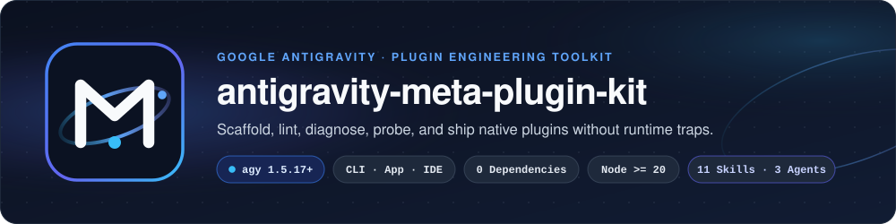
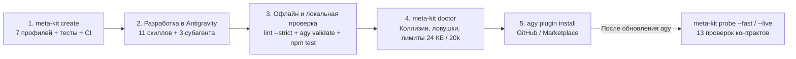

<div align="center">

<a href="https://antigravity.google">
  <picture>
    <source media="(prefers-color-scheme: dark)" srcset="docs/assets/banner-dark.svg" />
    <source media="(prefers-color-scheme: light)" srcset="docs/assets/banner-light.svg" />
    
  </picture>
</a>

<br />

[](https://antigravity.google)
[](docs/guides/plugin-manifest.ru.md)
[](https://github.com/sipki-tech/antigravity-meta-plugin-kit/actions/workflows/ci.yml)
[](package.json)
[](package.json)
[](LICENSE)

<p>
  <strong>Генерируйте, проверяйте, диагностируйте, тестируйте пробами и выпускайте плагины <a href="https://antigravity.google">Google Antigravity</a> без тихих runtime-ловушек.</strong><br />
  Zero-dependency тулкит на Node.js, откалиброванный живыми пробами на <code>agy 1.5.17 / 1.5.18</code> — единый CLI, модульный офлайн CI-линтер, локальный <code>doctor</code>, fail-open SDK для хуков, 11 скиллов, 3 изолированных субагента и двуязычные гайды.
</p>

<p>
  <a href="README.md">English</a> · <strong>Русский</strong>
  &nbsp;&nbsp;|&nbsp;&nbsp;
  <a href="#быстрый-старт-30-секунд">Быстрый старт</a> ·
  <a href="#выбор-профиля-генерации">Профили</a> ·
  <a href="#единый-cli-meta-kit">CLI</a> ·
  <a href="#скиллы-и-изолированные-субагенты">Скиллы и субагенты</a> ·
  <a href="#гайды-и-реестр-ловушек">Гайды</a>
</p>

</div>

---

## Как всё устроено



## Быстрый старт (30 секунд)

### 1. Установите в Antigravity (рекомендуется)

Один раз поставьте глобально через нативный CLI Antigravity — без `npm install`, без глобальных хуков и без раздутых always-on правил:

```bash
agy plugin install https://github.com/sipki-tech/antigravity-meta-plugin-kit
```

Удобный алиас для терминала, чтобы запускать `meta-kit` из любого проекта без клонирования репозитория:

```bash
alias meta-kit='node ~/.gemini/config/plugins/antigravity-meta-plugin-kit/scripts/meta-kit.mjs'
```

*(Нужно ограничить кит одним проектом? Положите `plugins/antigravity-meta-plugin-kit/` в `<project>/.agents/plugins/antigravity-meta-plugin-kit/` и закоммитьте. Обновление — повторный `agy plugin install`, замена атомарная.)*

### 2. Сгенерируйте и проверьте первый плагин

```bash
meta-kit create my-plugin --with-agents
cd my-plugin
npm test                                               # zero-dep тесты node:test (зелёные из коробки)
meta-kit lint --strict .                               # офлайн строгий линт + слепые зоны рантайма
agy plugin validate --strict --json plugins/my-plugin  # официальный валидатор Google (findings: [])
agy plugin install plugins/my-plugin                   # локальная установка в Antigravity
```

### 3. Подключите офлайн-линт в GitHub Actions

На раннерах GitHub Actions нет предустановленного `agy`. Добавьте этот шаг в любой репозиторий плагина, чтобы ловить ошибки схемы и runtime-ловушки на каждом PR:

```yaml
- uses: actions/setup-node@v4
  with:
    node-version: "22"
- run: npm test
- name: Офлайн строгий линт плагина Antigravity
  run: |
    git clone --depth 1 https://github.com/sipki-tech/antigravity-meta-plugin-kit /tmp/meta-kit
    node /tmp/meta-kit/plugins/antigravity-meta-plugin-kit/scripts/meta-kit.mjs lint --strict .
```

## Выбор профиля генерации

Каждый профиль из коробки проходит `npm test`, `meta-kit lint --strict` и `agy plugin validate --strict --json` (`findings: []`):

| Задача | Команда | Что генерируется |
|---|---|---|
| Стандартный плагин (хуки + MCP + скилл + правило) | `meta-kit create my-plugin` | Плоский `plugin.json`, `assets/logo.svg`, `README.md`, `rules/AGENTS.md`, fail-open `PreToolUse` (`io.mjs`), скилл, `mcp_config.json`, тесты, CI |
| Минимальный плагин (только скилл и правило) | `meta-kit create my-plugin --minimal` | Без `hooks.json`, скриптов хуков и `mcp_config.json` |
| Паттерн Google Workspace (CLI + `auth.json` + скилл) | `meta-kit create my-plugin --minimal --with-cli` | Встроенный zero-dep Node CLI (`scripts/cli.mjs`), `auth.json`, CLI-скилл, `test/cli.test.mjs` — без тяжёлого MCP |
| Свой субагент + `/cmd`-обёртка | `meta-kit create my-plugin --with-agents` | Канонический `agents/<name>-helper.md` (`model: inherit`, `inheritMcp: false`) + slash-скилл `/<name>-help` |
| Фоновый воркер-сайдкар | `meta-kit create my-plugin --with-sidecar` | `sidecars/<name>-worker/sidecar.json` + `worker.mjs` с обработкой `SIGTERM`/`SIGINT` |
| Манифест в `.antigravity-plugin/` | `meta-kit create my-plugin --manifest-layout dot-antigravity` | Кладёт `plugin.json` в `.antigravity-plugin/`, сохраняя все компоненты в корне плагина |

Добавьте `--dry-run` к любой команде для предпросмотра плана без записи на диск.

<details>
<summary><strong>Посмотреть структуру сгенерированного репозитория</strong></summary>

```text
my-plugin/
├── plugins/my-plugin/
│   ├── plugin.json               # плоский строгий JSON agy 1.5.17+ (или .antigravity-plugin/plugin.json)
│   ├── README.md                 # описание для UI Marketplace
│   ├── assets/logo.svg           # квадратный SVG 256×256 с полями ~10% (0 notes в валидаторе)
│   ├── rules/AGENTS.md           # always-on правило (без frontmatter, рекомендация Google)
│   ├── hooks.json                # корневой строгий JSON, fail-open PreToolUse (без него в --minimal)
│   ├── scripts/example-guard.mjs + scripts/lib/io.mjs   # symlink-safe fail-open SDK хуков
│   ├── skills/my-plugin-example/SKILL.md + resources/prompt-template.md
│   ├── skills/my-plugin-help/SKILL.md                   # --with-agents (disable-model-invocation: true)
│   ├── skills/my-plugin-cli/SKILL.md                    # --with-cli
│   ├── agents/my-plugin-helper.md                       # --with-agents (model: inherit, inheritMcp: false)
│   ├── sidecars/my-plugin-worker/sidecar.json           # --with-sidecar
│   ├── auth.json + scripts/cli.mjs                      # --with-cli (паттерн Google Workspace)
│   └── mcp_config.json                                  # без него в --minimal
├── test/                         # тесты node:test (hook.test.mjs + manifest.test.mjs + cli.test.mjs)
├── README.md
└── .github/workflows/ci.yml      # Node 20/22 × ubuntu/macos + agy plugin validate --strict
```

</details>

## Единый CLI (`meta-kit`)

Все четыре команды объединены в `scripts/meta-kit.mjs` (прямые скрипты `create.mjs`, `lint.mjs`, `doctor.mjs` и `probe.mjs` остаются на 100% совместимыми):

| Команда | Назначение | Основные флаги |
|---|---|---|
| `meta-kit create <name>` | Генерация готового репозитория плагина | `--minimal`, `--with-agents`, `--with-sidecar`, `--with-cli`, `--manifest-layout`, `--dir`, `--dry-run` |
| `meta-kit lint <target>` | Офлайн строгий линт плагинов **и** `marketplace.json` | `--strict`, `--json`, `--all` |
| `meta-kit doctor` | Read-only аудит `~/.gemini/config/` и `.agents/` (коллизии, симлинки, ловушки, лимиты 24 КБ / 20k) | `--workspace <dir>`, `--home <dir>`, `--strict`, `--json` |
| `meta-kit probe` | Проверка локального `agy` по 9 быстрым + 4 живым контрактам в `/tmp` | `--fast` (~2с), `--live`, `--model <id>`, `--json` |

<details>
<summary><strong>Примеры вывода: <code>meta-kit probe --fast</code> и <code>meta-kit doctor</code></strong></summary>

```text
$ meta-kit probe --fast
agy version: 1.5.18 (builtin docs: present)
CONFIRMED  baseline_clean_strict
CONFIRMED  legacy_manifest_fields_warn
CONFIRMED  agents_concrete_model_error_and_toml_ignored
CONFIRMED  rules_trigger_and_globs_string
CONFIRMED  workflows_never_loaded_warn
CONFIRMED  hooks_session_start_and_prompt_blind_spot
CONFIRMED  sidecar_validates
CONFIRMED  marketplace_archive_sha256_contract
CONFIRMED  auth_json_validator_blind_spot
probe: 9/9 contracts confirmed
```

```text
$ meta-kit doctor --workspace .
doctor: workspace=/path/to/your-project
        home=/Users/you
plugins: 9/9 enabled  |  skills=34  agents=3  rules=1
always_on rules budget: ~168/20000 tokens (669 B across 1 file(s))
  [global] my-plugin   enabled   lint OK
...
```

</details>

## Зачем это существует

В Antigravity `1.5.17+` появился сильный встроенный валидатор (`agy plugin validate --strict`), **но для инженеров плагинов остались три реальных пробела**:

1. **Офлайн-CI и инженерия репозитория:** встроенный `/plugin` создаёт голую папку в `~/.gemini/config/plugins/` без тестов, SDK хуков и CI, а на раннерах GitHub Actions нет установленного `agy`.
2. **Runtime-слепые зоны, которые проходят `agy plugin validate --strict` и ломаются в бою** (подтверждено живыми пробами на `agy 1.5.17 / 1.5.18`):
   - `agents/*.toml` тихо пропускаются (`agents: 0`) без единого предупреждения.
   - Опечатки в `tools:` внутри `agents/*.md` роняют старт субагента, а старый `grep_search` тихо выдаёт 0 инструментов поиска.
   - `model: pro` резолвится в Hydrogen xhigh вместо сохранения родительской сессии Neon/Carbon/Argon (`model: inherit` сохраняет).
   - Хуки `type: "prompt"` проходят `--strict`, но валят каждый вызов инструмента в рантайме.
   - `Stop`-хуки, проверяющие только `continuationActive`, могут зациклиться, так как `continuationActive` остаётся `false` при `executionNum > 0`.
   - `injectSteps: [{"toolCall": ...}]` роняет ход с кодом выхода 3.
   - Эндпоинты `/sse` в MCP, скобки `{ts,tsx}` в `globs` и битый `auth.json` проходят `--strict` без предупреждений.
3. **Ноль глобального шума:** установка кита не вешает глобальные хуки и always-on правила на чужие проекты (`rules/plugin-authoring.md` использует `trigger: model_decision`).

| Проверка | `agy plugin validate --strict` | `meta-kit lint --strict` |
|---|:---:|:---:|
| Работает в GitHub Actions без установленного `agy` | — | ✔ |
| Поля манифеста, `logo`, `suggestedPrompts`, JSONC | ✔ | ✔ |
| Тихо игнорируемые `agents/*.toml` | — | ✔ (`FAIL`) |
| Опечатки в `tools:` субагента и мёртвый `grep_search` | — | ✔ (`FAIL` / `WARN`) |
| Runtime-крэш `PromptHook` и защита цикла `Stop` (`continueStopResponse`) | — | ✔ (`FAIL` / `WARN`) |
| Эвристика fail-open в скриптах хуков и проверка выхода путей за корень | — | ✔ (`FAIL` / `WARN`) |
| Скобки `{a,b}` в `globs` и раздутые always-on правила | — | ✔ (`WARN`) |
| Эндпоинты `/sse`, булево `tools.*.background` и секреты в `env`/`headers` | — | ✔ (`FAIL` / `WARN`) |
| Провайдеры `auth.json`, OAuth URL и захардкоженные секреты | — | ✔ (`FAIL` / `WARN`) |
| Офлайн-проверка `marketplace.json` (`archive` + `https://` + `sha256`) | сетевой fetch | ✔ (`FAIL`) |
| Триггеры скилла и лимит обрезки 24 КБ | только 24 КБ | ✔ (`FAIL`) |

## Проверки линтера и слепые зоны

Код выхода `1` при любом `FAIL`; `--strict` также падает на warnings, `--json` выдаёт отчёт для CI, `--all` проверяет все плагины в монорепозитории.

<details>
<summary><strong>Полная матрица проверок всех 11 модулей линтера (<code>scripts/lib/lint/*.mjs</code>)</strong></summary>

| Область | Что проверяет `meta-kit lint` |
|---|---|
| `plugin.json` | приоритет манифестов (`.antigravity-plugin/` > `.gemini-plugin/` > корень), строгий JSON (warn на JSONC), semver, kebab-case `name`, строка/объект `author`, `https://` URL, `logo` (файл/расширение/dot-папки), `suggestedPrompts` <= 3, warn на мёртвые ключи (`interface`, `rules`, `hooks`, `agents`, `mcpServers`) |
| `agents/` | только Markdown (`agents/*.md`, `agents/*/agent.md`, `agents.json`); **FAIL на тихо игнорируемые `agents/*.toml`**, невалидный тир `model` (`inherit`/`flash_lite`/`flash`/`pro`), невалидную `commandExecutionPolicy` (`off`/`auto`/`eager`/`sandbox`), неизвестные `tools:`, зарезервированные имена; **warn на мёртвый `grep_search`** и legacy-алиасы |
| `rules/` | строго заглавные `rules/AGENTS.md` / `rules/GEMINI.md` или валидный `trigger` (`always_on`/`model_decision`/`glob`/`manual`), `globs` строкой (не YAML-массив), **warn на `{a,b}`**, корневой `AGENTS.md`, лимит 24 000 Б, раздутые always-on правила (>150 строк) |
| `skills/` | многострочный YAML (`>-`/`|`), списки с 0-отступом, `name` = папке, триггеры (пропускаются для `disable-model-invocation: true`), **лимит тела 24 000 Б**, warn на незагружаемые `workflows/*.md` и `commands/` |
| `hooks.json` | корневой строгий JSON, именованные группы, 6 нативных событий, валидный regex матчера, целые таймауты <= 30с, **FAIL на `type: "prompt"`**, fail-open проверка скриптов, **warn на отсутствие защиты цикла в `Stop`** (литерал `"continue"` и `continueStopResponse()`), устаревшие `model_stop`/`ephemeralMessage`, крэшащий `injectSteps[].toolCall`, выход пути скрипта за корень и `PLUGIN_ROOT` в командах |
| `mcp_config.json` | поддержка JSONC, проверка транспортов, `disabled: true` для не-`node`/`npx`, строковый `tools.<name>.background` (`"off"` / `"always"`), точная матрица `${PLUGIN_ROOT}`/`${PLUGIN_DATA}` vs `variables[]`, **warn на `/sse`**, `httpUrl`, `${env:...}` и захардкоженные секреты в `env` и `headers` |
| `auth.json` | **слепая зона валидатора:** строгий JSON, карта `providers`, `type` (`oauth2`/`api_key`/`bearer`/`basic`), HTTPS URL и `scopes` для `oauth2`, `delivery`/`env`, поиск захардкоженных секретов |
| `marketplace.json` | строгий JSON, уникальные kebab-case имена, SemVer, объект `source` с `type: "archive"`, `https://` `url` и 64-hex `sha256` |
| `sidecars/` | `sidecars/<id>/sidecar.json` и `sidecars.json` (`command` XOR `builtin`, `restart_policy`, проверка симлинков, неизвестные поля) |

</details>

## Скиллы и изолированные субагенты

После установки просто общайтесь с Antigravity естественным языком — или вызывайте детерминированные slash-команды:

- **3 slash-команды (`disable-model-invocation: true`):**
  - `/meta-audit` — запускает `meta-kit lint --strict`, `agy plugin validate --strict --json`, собирает дерево файлов и делегирует глубокий семантический аудит субагенту `meta-payload-auditor`.
  - `/meta-doctor` — запускает read-only `meta-kit doctor` по `~/.gemini/config/` и `.agents/`, выявляя коллизии, runtime-ловушки и жёсткие лимиты 24 КБ / 20k.
  - `/meta-scout` — запускает `meta-kit probe --fast` (или `--live`) и делегирует анализ дрейфа после обновления Antigravity субагенту `meta-trap-scout`.
- **8 специализированных экспертных скиллов** в [plugins/antigravity-meta-plugin-kit/skills/](plugins/antigravity-meta-plugin-kit/skills/):
  `meta-scaffold`, `meta-agents`, `meta-hooks`, `meta-skills`, `meta-rules`, `meta-mcp`, `meta-test`, `meta-ship`.
- **3 изолированных субагента (`model: inherit`, `inheritMcp: false`, `mainAgent: false`)** в [plugins/antigravity-meta-plugin-kit/agents/](plugins/antigravity-meta-plugin-kit/agents/):

| Субагент | Политика · Tools | Задача |
|---|---|---|
| `meta-payload-auditor` | `off` · `[read_file]` | Семантический аудит поверх линта: качество триггеров, дизайн субагентов, логика хуков, бюджеты правил, связность манифеста |
| `meta-hook-smith` | `off` · `[read_file]` | Проектирует полные fail-open комплекты хуков (`hooks.json`, обработчик на `io.mjs`, юнит- и e2e-тесты `node:test`) |
| `meta-trap-scout` | `sandbox` · `[read_file, run_command, search_web]` | Эмпирический поиск дрейфа через `probe.mjs`, дифф встроенных доков и анализ бинарников |

Плюс одно условное правило `trigger: model_decision` ([rules/plugin-authoring.md](plugins/antigravity-meta-plugin-kit/rules/plugin-authoring.md)), которое включается только при работе над плагинами Antigravity.

## Гайды и реестр ловушек

Одиннадцать двуязычных гайдов (EN/RU) плюс реестр ловушек с тегами источников ([docs/internals.md](docs/internals.md)) по всем компонентам Antigravity `1.5.17+`:

| Гайд | Что покрывает |
|---|---|
| [Getting started](docs/guides/getting-started.md) · [RU](docs/guides/getting-started.ru.md) | установка -> `alias meta-kit` -> scaffold -> lint -> test -> `doctor` -> локальный install |
| [Работа с плагином](docs/guides/using-the-plugin.md) · [RU](docs/guides/using-the-plugin.ru.md) | повседневные промпты: 8 скиллов, `/meta-audit`, `/meta-doctor`, `/meta-scout`, субагенты |
| [Манифест и раскладки](docs/guides/plugin-manifest.md) · [RU](docs/guides/plugin-manifest.ru.md) | плоский `plugin.json`, `.antigravity-plugin/`, `logo`, `suggestedPrompts`, `config.json` |
| [Субагенты](docs/guides/agents.md) · [RU](docs/guides/agents.ru.md) | `agents/*.md` и `agents/*/agent.md`, живой маппинг `model`, нативные `tools:`, `inheritMcp`, `commandExecutionPolicy` |
| [Хуки](docs/guides/hooks.md) · [RU](docs/guides/hooks.ru.md) | 6 нативных событий, `overwrite`, `systemMessage`, `NO_TOOL_CALL` + `executionNum > 0`, fail-open `io.mjs`, ловушка `PromptHook` |
| [Скиллы](docs/guides/skills.md) · [RU](docs/guides/skills.ru.md) | анатомия `SKILL.md`, многострочный YAML, позитивные/негативные триггеры, порог 24 КБ, `disable-model-invocation` |
| [Правила и воркфлоу](docs/guides/rules-workflows.md) · [RU](docs/guides/rules-workflows.ru.md) | `rules/AGENTS.md`, 4 триггера, ловушки `globs`, бюджеты 24 КБ / 20k, миграция мёртвых `workflows/` в скиллы |
| [MCP-серверы](docs/guides/mcp.md) · [RU](docs/guides/mcp.ru.md) | Streamable HTTP vs Stdio, матрица переменных, `eager`, `background`, MCP Apps, альтернатива CLI + `auth.json` |
| [Тестирование](docs/guides/testing.md) · [RU](docs/guides/testing.ru.md) | zero-dep `node:test`, e2e-тесты хуков, `agy plugin validate --strict --json`, изолированный `agy -p` smoke |
| [Релиз](docs/guides/shipping.md) · [RU](docs/guides/shipping.ru.md) | нативный `agy plugin install`, pre-flight Marketplace, `marketplace.json` `sha256`, офлайн-CI |
| [Исследование Antigravity](docs/guides/researching-antigravity.md) · [RU](docs/guides/researching-antigravity.ru.md) | встроенные доки, 2 Go-бинарника, `meta-kit probe --fast/--live`, повторяемый пайплайн |

## FAQ

**Работает ли кит с Antigravity CLI (`agy`), Antigravity App и Antigravity IDE?**
Да. Начиная с Antigravity IDE `2.7.0`, IDE напрямую запускает `agy --hub`, так что все три поверхности используют единый Go-загрузчик и плоский `plugin.json`.

**Почему ноль зависимостей?**
Скрипты и хуки запускаются прямо внутри пользовательских сессий и на раннерах CI. Ноль зависимостей — это мгновенный старт на Node >= 20 без `npm install` и лишней поверхности атаки.

**Мешает ли установка плагина обычным проектам?**
Нет. В `v0.6.0` нет глобальных хуков, а единственное правило использует `trigger: model_decision`.

**Почему субагент с `model: pro` не запускается на Neon или Carbon?**
Живые пробы на `agy 1.5.17 / 1.5.18` показали, что `pro` мапится на `gemini-4-hydrogen-tiered-xhigh`, тогда как `inherit` сохраняет точную модель родителя (Neon, Carbon, Argon или Claude). Для сильных специалистов используйте `model: inherit` (или опустите `model:`).

## Разработка

```bash
npm test                                               # 60 тестов (0 skipped), включая паритет EN/RU и проверку ссылок/SVG
npm run lint                                           # строгий самолинт
npm run probe                                          # 9 быстрых валидаторных контрактов
npm run doctor                                         # локальный read-only аудит среды
agy plugin validate --strict --json plugins/antigravity-meta-plugin-kit
```

Ноль runtime-зависимостей (только встроенные модули Node >= 20). См. [CONTRIBUTING.md](CONTRIBUTING.md).

## Лицензия

MIT
